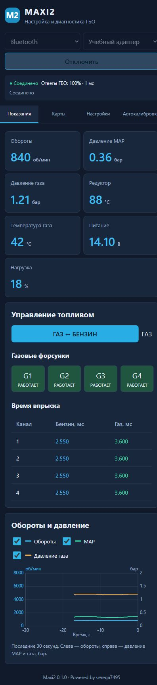
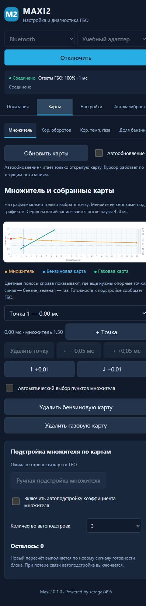
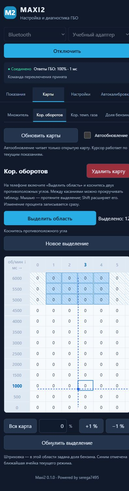
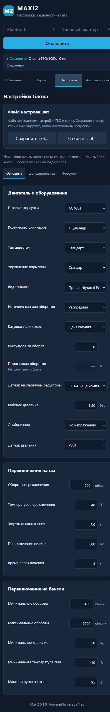
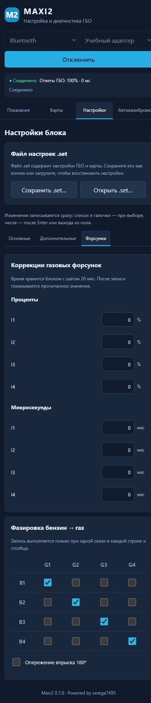
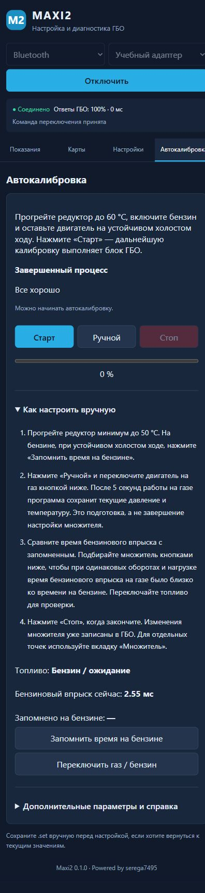

# Maxi2

Приложение для настройки и диагностики ГБО **Digitronic Maxi-2** на Android.

[Скачать последнюю версию APK](https://github.com/serega7495/maxi2-downloads/releases/latest)

## Возможности

- Подключение через Bluetooth Classic SPP или USB–UART через USB OTG.
- Обороты двигателя, MAP, давление газа, температуры и времена впрыска.
- Общий график оборотов и давления с выбором видимых линий.
- Переключение газ/бензин и управление отдельными форсунками.
- Множитель, бензиновая и газовая карты, коррекции по оборотам, температуре и давлению.
- Выделение нескольких ячеек таблицы на телефоне, изменение точек кривых кнопками.
- Основные настройки, коррекции форсунок и фазировка.
- Автокалибровка, ручной режим и подстройка множителя по картам.
- Сохранение и загрузка настроек и карт в файл `.set`.
- Независимое подключение ELM327: топливные коррекции STFT/LTFT, показания и ошибки OBD, выбор протокола автоматически или вручную.
- Подстройка по OBD: сбор замеров на бензине и газе, рекомендации по множителю и коррекции оборотов, запись лога в файл.
- Автопереподключение к ГБО и ELM327 после разрыва связи, демо-режим.
- Одинаковые стрелки на карте множителя с движением при удержании; запись через 2 секунды после отпускания.

## Установка и подключение

1. Скачайте APK из раздела [Releases](https://github.com/serega7495/maxi2-downloads/releases).
2. Разрешите установку из выбранного браузера или файлового менеджера и установите приложение.
3. Для Bluetooth сначала выполните сопряжение адаптера в настройках Android.
4. В Maxi2 выберите Bluetooth или USB–UART, устройство и нажмите «Подключить».

Нужны Android 7.0 или новее и актуальный Android System WebView.
Bluetooth LE не поддерживается. Один адаптер должен использоваться одной программой одновременно.
Для чтения ошибок и топливных коррекций бензинового ЭБУ нужен отдельный адаптер ELM327; подключение к нему настраивается во вкладке «OBD / ELM327».
Поддержка `.set` проверена с Maxi2 1.7.1 / 34.3.2; перед настройкой сохраните свой файл `.set`.

## Интерфейс

| Показания и график | Множитель и карты |
|---|---|
|  |  |

| Таблицы коррекций | Настройки и файлы .set |
|---|---|
|  |  |

| Форсунки и фазировка | Автокалибровка |
|---|---|
|  |  |

В этом репозитории публикуются готовые выпуски и документация приложения.
